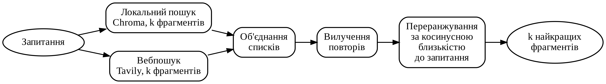

# RAG Trust Evaluation

**Master's thesis, Igor Sikorsky Kyiv Polytechnic Institute (2026).**
A test bench that answers questions with retrieval-augmented generation (RAG) and estimates **how much each answer can be trusted** — without a reference answer.


## What it does

- **Four retrieval modes:** no context, local documents (ChromaDB), web search (Tavily) and combined.
- **Nine evaluation methods** compared on the same answers: ROUGE, BERTScore, NLI (multilingual DeBERTa), RAGAS, SelfCheck, three LLM-as-a-judge variants (plain, rubric, pairwise) and decision usefulness.
- **Trust score:** logistic regression over the best reference-free metrics, mapped to low / medium / high trust.
- **Experiment runner:** every question × mode × method, with retries, resume and token / cost tracking in SQLite.
- **Streamlit UI:** upload PDF / DOCX / TXT, ask a question, see the answer, its sources and the trust level.



## Project structure

```
app.py               Streamlit interface
pipeline.py          question + mode → answer and contexts
retrievers.py        local, web and combined search, deduplication, reranking
evaluators/          ROUGE, BERTScore, NLI, RAGAS, SelfCheck, LLM judges, decision usefulness
trust_score.py       aggregated trust score
run_experiments.py   batch experiments over the golden set
data/golden_set.json 32 evaluation questions
tests/               unit tests (13)
```

## Run

```bash
pip install -r requirements.txt
cp .env.example .env          # add OPENAI_API_KEY, ANTHROPIC_API_KEY, TAVILY_API_KEY
python ingest.py              # build the document index
streamlit run app.py          # UI
python run_experiments.py     # batch evaluation
python -m unittest tests.test_core -v
```
